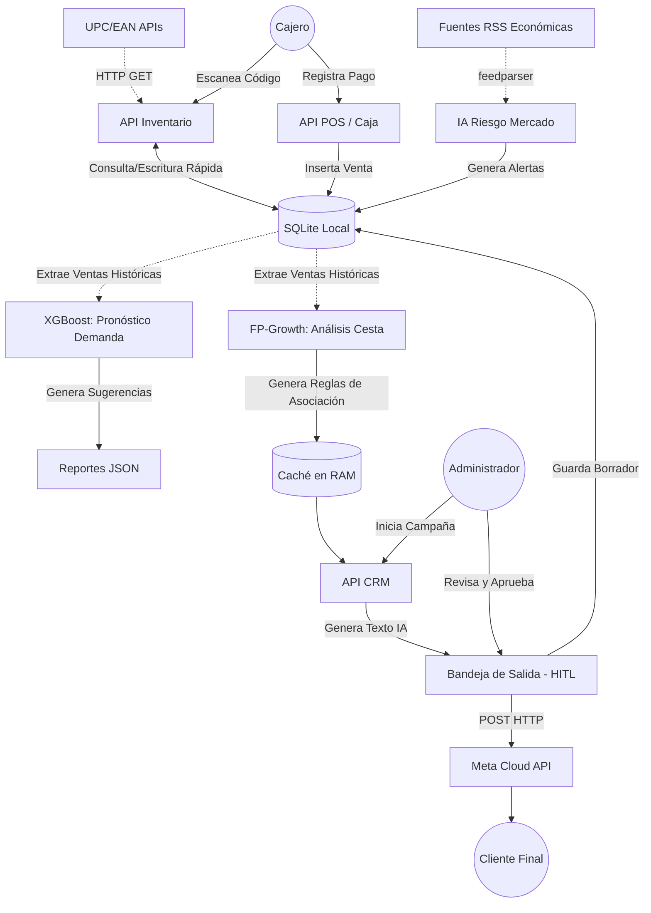

# 🏪 Ecosistema Inteligente POS (Punto de Venta)

¡Hola! Bienvenido al repositorio de mi **MVP de Ecosistema Inteligente para Bodegas**. 
Diseñé esta arquitectura pensando en un problema muy claro: **la lentitud en caja**. Por eso, este sistema está construido para operar con latencia cero en el cobro, mientras relega todas las tareas pesadas (Machine Learning, Inteligencia de Mercado y CRM por WhatsApp) a procesos asíncronos y en segundo plano.

---

## 📑 Tabla de Contenidos

1. [Arquitectura del Sistema (4 Pilares)](#-arquitectura-del-sistema-4-pilares)
2. [Flujo de Datos (Diagrama)](#-flujo-de-datos-diagrama)
3. [Tecnologías Utilizadas](#%EF%B8%8F-tecnologías-utilizadas)
4. [Estructura del Proyecto](#-estructura-del-proyecto)
5. [Esquema de Base de Datos Relacional](#-esquema-de-base-de-datos-relacional)
6. [Instrucciones de Instalación y Despliegue](#%E2%9A%99%EF%B8%8F-instrucciones-de-instalación-y-despliegue)
7. [Ejecución de Modelos Analíticos (Batch Jobs)](#-ejecución-de-modelos-analíticos-batch-jobs)

---

## 🚀 Arquitectura del Sistema (4 Pilares)

1. **Caja (POS) Ultrarrápida**: Operaciones locales con SQLite para no depender de la latencia de internet durante el cobro. Cierre de caja integrado por métodos de pago.
2. **Inventario Auto-Gestionado**: Si escaneas un código de barras que no existe, el sistema busca automáticamente la metadata e imagen en APIs externas (UPC/EAN) y lo registra por ti.
3. **Optimización e Inteligencia de Mercado**:
    * Análisis automatizado de noticias económicas locales (RSS vía `feedparser`) usando IA.
    * Modelos predictivos (XGBoost) para sugerir puntos de reorden (cuánto stock comprar) basados en la historia de demanda de la bodega (Time Series).
4. **CRM y Fidelización con IA**:
    * Utiliza *Market Basket Analysis* (FP-Growth) para descubrir patrones de "venta cruzada".
    * Utiliza *Gemini 1.5 Flash* para redactar mensajes ultra-personalizados.
    * Integra un patrón **Human-In-The-Loop (HITL)** para enviar sugerencias por WhatsApp Business de forma segura y supervisada por un administrador.

---

## 📊 Flujo de Datos (Diagrama)

A continuación, se ilustra la separación estricta entre las operaciones síncronas de caja (baja latencia) y los procesos analíticos pesados (asíncronos/background):



---

## 🛠️ Tecnologías Utilizadas

* **Backend**: Python 3, FastAPI, Uvicorn, SQLAlchemy.
* **Base de Datos**: SQLite (optimizada para lecturas ultrarrápidas).
* **Machine Learning**: `xgboost`, `scikit-learn`, `mlxtend` (FP-Growth), Pandas.
* **Integraciones AI/API**: Google Generative AI (Gemini API), WhatsApp Business Cloud API (Meta).
* **Ciberseguridad**: JWT Auth (Bcrypt/Passlib), RBAC, Rate Limiting (`slowapi`), CORS estricto.

---

## 📂 Estructura del Proyecto

```text
pos_mvp/
├── app/                        # Aplicación FastAPI
│   ├── api/                    # Endpoints y Rutas
│   │   ├── deps.py             # Dependencias (JWT, Validaciones RBAC)
│   │   └── endpoints/          # Rutas: inventory, market, pos, crm
│   ├── core/                   # Configuraciones core (Seguridad, Base de Datos, Rate Limiter)
│   ├── crud/                   # Consultas y transacciones hacia SQLite
│   ├── models/                 # Modelos ORM (User, Customer, Product, Sale, Outbox, etc.)
│   ├── schemas/                # Modelos Pydantic para validación estricta de Entradas/Salidas
│   └── services/               # Lógica de negocio pesada (CRM, integraciones externas, Web Fetching)
├── reports/                    # Archivos generados (JSON, reportes de inventario)
├── scripts/                    # Scripts Background (Ideales para Cron Jobs)
│   ├── inventory_optimization.py # Motor XGBoost y cálculos de stock de seguridad
│   ├── run_market_analysis.py    # IA para análisis de riesgo de mercado
│   └── train_crm_model.py        # Entrenamiento batch del modelo FP-Growth
├── pos_mvp.db                  # Base de datos SQLite local (Generada en el primer arranque)
├── .env                        # Variables de entorno secretas (No commiteadas)
├── .env.example                # Plantilla de referencia para credenciales
└── requirements.txt            # Dependencias estandarizadas del proyecto
```

---

## 🔒 Esquema de Base de Datos Relacional

El sistema está soportado por un esquema relacional limpio y normalizado:
* **users**: Control de acceso con roles (`admin`, `cajero`). Las contraseñas se almacenan mediante Hashes Bcrypt.
* **products**: Catálogo que incluye códigos de barras, metadata de mercado y URLs de imágenes oxigenadas.
* **customers**: Directorio de clientes recurrentes y sus números telefónicos de WhatsApp.
* **sales** & **sale_items**: Registro transaccional de ventas, incluyendo la asociación mediante Enum a métodos de pago (`Efectivo`, `Tarjeta`, `Yape`, `Plin`).
* **mensajes_outbox**: Bandeja de salida clave para la supervisión humana de la IA (HITL).
* **market_alerts**: Alertas de riesgo de mercado procesadas asíncronamente desde fuentes RSS.

---

## ⚙️ Instrucciones de Instalación y Despliegue

Sigue estos pasos para levantar el entorno local en tu máquina Windows, Mac o Linux:

### 1. Crear el Entorno Virtual
Abre tu terminal en la raíz del proyecto y crea un entorno virtual para aislar las dependencias:
```bash
python -m venv venv
```

### 2. Activar el Entorno Virtual
```bash
# En Windows (Powershell o CMD):
venv\Scripts\activate

# En Mac o Linux:
source venv/bin/activate
```

### 3. Instalar Dependencias
Instala todas las librerías necesarias con `pip` (asegúrate de tener el entorno activo):
```bash
pip install -r requirements.txt
```

### 4. Configurar Variables de Entorno
Copia la plantilla provista para crear el archivo real `.env`. Completa tus credenciales de Google Gemini y WhatsApp Cloud API:
```bash
# En Windows
copy .env.example .env
```
*(Abre el archivo `.env` en tu IDE favorito y pega tus tokens reales para habilitar el motor de NLP y WhatsApp)*

### 5. Levantar el Backend (FastAPI)
Ejecuta el servidor con `uvicorn`. La aplicación regenerará las tablas de la base de datos de manera automática si detecta que es el primer inicio.
```bash
uvicorn app.main:app --reload
```
✅ **¡El Backend ya está corriendo!**
Podrás acceder a la interfaz y explorar los endpoints a través de Swagger UI:
👉 **[http://localhost:8000/docs](http://localhost:8000/docs)**

---

## 🤖 Ejecución de Modelos Analíticos (Batch Jobs)

La API FastAPI está pensada únicamente para ser ligera y transaccional (Caja). El entrenamiento y procesamiento estadístico masivo se corre *fuera* de la API.

Puedes ejecutar manualmente estos scripts (o configurarlos con Tareas Programadas de Windows / Cron en Linux) preferentemente por las madrugadas:

```bash
# 1. Entrena el algoritmo de venta cruzada con las transacciones del día
python scripts/train_crm_model.py

# 2. Genera los pronósticos a 14 días y sugerencias de compra a proveedores
python scripts/inventory_optimization.py

# 3. Descarga noticias RSS y genera el reporte de riesgos macroeconómicos
python scripts/run_market_analysis.py
```

---
*Construido con orgullo, enfocándome en Clean Architecture, DevSecOps y Data Engineering.*
